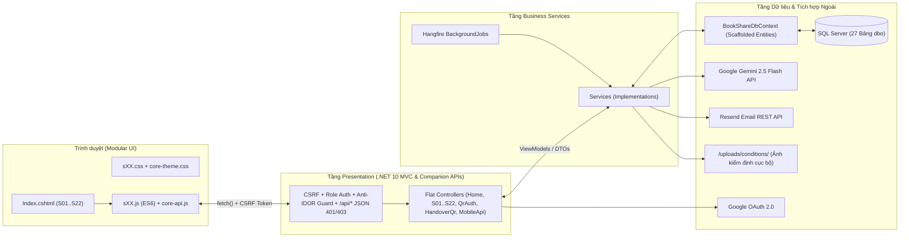
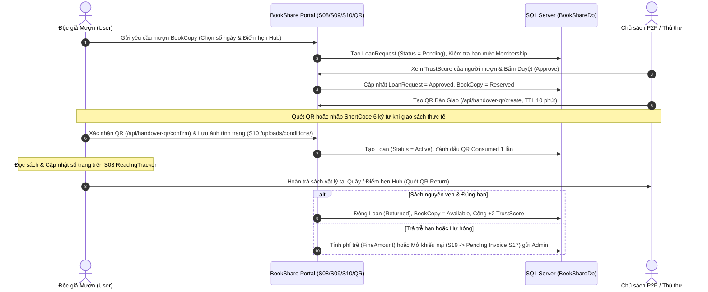

# KIẾN TRÚC TỔNG THỂ HỆ THỐNG BOOKSHARE (ASP.NET CORE 10 MVC)

> **Dự án:** BookShare — Nền tảng Quản lý Tủ sách Cá nhân, Theo dõi Tiến độ Đọc & Chia sẻ Sách Giấy Cộng đồng (Kho chung Thư viện & P2P)  
> **Nền tảng kỹ thuật:** ASP.NET Core 10 MVC (.NET 10) • EF Core 10 (Database-First Scaffold) • SQL Server (`27 bảng dbo`) • ASP.NET Core Identity • Hangfire • Gemini 2.5 Flash (Function Calling) • Resend API • Lưu trữ ảnh kiểm định cục bộ `/uploads/conditions/` • Android WebView Shell (`mobile/bookshare-android/`)  
> **Kế thừa & Mở rộng:** Phát triển từ nền tảng giao diện và trải nghiệm của `book-tracker-ver07` lên cổng dịch vụ (Portal) 4 cấp phân quyền, 22 phân hệ nghiệp vụ độc lập, QR Auth 2 chiều, QR Bàn giao sách và ứng dụng di động Android.

---

## 1. Nguyên tắc Nghiệp vụ Bất khả Xâm phạm

1. **Định vị hệ thống ("Airbnb cho sách giấy" + Trợ lý đọc sách cá nhân):**
   - Kết hợp **Quản lý tủ sách cá nhân & Theo dõi tiến độ đọc** (kế thừa từ `book-tracker-ver07`) với **Mượn sách Kho chung (Thư viện trường/đối tác)** và **Mượn sách P2P giữa các cá nhân**.
2. **TUYỆT ĐỐI KHÔNG PHẢI WEB BÁN SÁCH:**
   - **Cấm tuyệt đối:** Nút `"Mua ngay"`, `"Thêm vào giỏ hàng"`, trang thanh toán mua bán sách, hoặc hiển thị `"Giá bán sách"`.
   - **Luồng nghiệp vụ chuẩn:** Quản lý kệ sách $\rightarrow$ Đặt mượn / Xếp hàng chờ $\rightarrow$ Duyệt yêu cầu $\rightarrow$ Giao/Nhận sách (kèm chụp ảnh tình trạng `ConditionReports`) $\rightarrow$ Theo dõi tiến độ đọc (`ReadingProgresses`) $\rightarrow$ Trả sách & Đánh giá uy tín 2 chiều (`TrustScore`).
   - Mọi giao dịch tài chính trên hệ thống (qua cổng Sandbox VNPay/MoMo) chỉ phục vụ: **Nâng cấp gói thành viên (Premium)**, **Nộp phí phạt trả trễ hạn (`FineAmount`)**, và **Tiền cọc mô phỏng (`SimulatedDeposit`)**.
3. **Chỉ giao dịch & chia sẻ Sách Giấy vật lý:**
   - Nghiêm cấm tải lên, lưu trữ hoặc chia sẻ tệp sách điện tử (Ebook/PDF/EPUB) vi phạm bản quyền. Mỗi bản sao vật lý được định danh bằng mã vạch (`Barcode`) trong bảng `BookCopies`.

---

## 2. Hệ thống Phân quyền 4 Vai trò (ASP.NET Core Identity Roles)

Hệ thống sử dụng ASP.NET Core Identity với 4 vai trò (`AspNetRoles`) được khóa bằng `[Authorize(Roles = "...")]` trên cấu trúc Controller phẳng thống nhất:

| STT | Mã Role | Tên Vai trò | Phạm vi Truy cập & Trách nhiệm Cốt lõi | Route Chính |
| :--- | :--- | :--- | :--- | :--- |
| **1** | `User` | **Độc giả & Chủ tủ sách cá nhân** | Quản lý tủ sách cá nhân (`Shelves`), bật/tắt trạng thái cho mượn (`IsLendable`), theo dõi tiến độ đọc & ghi chú, đặt mượn sách kho chung hoặc P2P, chụp ảnh biên bản tình trạng sách, đánh giá `TrustScore`, gửi đề nghị nâng quyền `Curator`. | `/S01..S19` |
| **2** | `Curator` | **Chủ nhiệm CLB / Điểm trạm Kiểm định P2P** | Xác minh sách thật ngoài đời tại câu lạc bộ/trường học, quản lý tủ sách CLB/nhóm sinh viên, vận hành Điểm hẹn giao nhận sách an toàn (`Book Drop-off Hub`), hỗ trợ xác nhận giao nhận P2P & QR bàn giao. | `/S20ExchangeHubClub` |
| **3** | `Librarian` | **Thủ thư Kho chung** | Quản lý kho sách thư viện trường/đối tác (`Libraries`), nhập lô sách mới bằng ISBN/Barcode, quét mã duyệt nhanh mượn/trả tại quầy, ghi nhận tình trạng sách trả và tính phí phạt trễ hạn. | `/S07..S08`, `/S21LibrarianDesk` |
| **4** | `Admin` | **Quản trị viên Hệ thống** | Quản lý toàn bộ tài khoản, xét duyệt đề nghị nâng quyền `Curator`, phân xử tranh chấp sách hỏng/mất (`Disputes`) khép kín với `S17`, cấu hình gói thành viên (`Memberships`), xem Dashboard thống kê & giám sát Hangfire Jobs. | `/S19DisputeResolution`, `/S22AdminAnalytics` |

---

## 3. Cấu trúc Thư mục Chuẩn Đối xứng (`BookShare`)

Mỗi phân hệ trong 22 phân hệ sở hữu **1 bộ 3 file tách biệt hoàn toàn** (`Views/Modules/Sxx_*/Index.cshtml` + `wwwroot/modules/sxx-*/*.{css,js}` ES6 Module) đi kèm bộ API đồng hành Sprint 3 & Android Native WebView Shell:

```plaintext
Quan_ly_tu_sach_ca_nhan/
├── .env                                  # Biến môi trường thật (Đã khóa trong .gitignore)
├── .env.example                          # Mẫu cấu hình biến môi trường chuẩn .NET 10 (Dấu __)
├── .gitignore                            # Chặn commit .env, bin/, obj/, .vs/, uploads cá nhân
├── .github/workflows/
│   └── build-bookshare-android-apk.yml   # Pipeline đóng gói BookShare-Mobile-Android.apk
├── database/
│   ├── 01_BookShare_Schema.sql           # Script T-SQL tạo 27 bảng dbo (22 chính + Identity + Sprint 3)
│   └── 02_BookShare_SeedData.sql         # Dữ liệu mẫu (4 roles, 6 users, 3 trạm, 35 đầu sách, 55 bản sao)
├── mobile/
│   └── bookshare-android/                # Android WebView Shell sạch (Light Mode #F8FAFC, Custom Tabs OAuth)
└── src/
    └── BookShare.Web/                    # Project ASP.NET Core 10 MVC chính
        ├── Program.cs                    # Điểm khởi đầu: DotNetEnv.Env.Load(), DI, Auth, /api/* JSON 401/403, Hangfire
        ├── appsettings.json              # Cấu hình mặc định không chứa khóa nhạy cảm
        ├── Controllers/                  # Flat Controllers: Home, S01..S22, HandoverQr, QrAuth, MobileApi
        ├── Models/
        │   ├── Entities/                 # Code tự sinh từ `dotnet ef dbcontext scaffold --schema dbo` (CẤM SỬA TAY)
        │   └── ViewModels/               # DTO / ViewModel cho S01 -> S22 & Sprint3ViewModels
        ├── Services/
        │   ├── Interfaces/               # IS01..IS22, ILoanFlowCoordinatorService, ISprint3Services...
        │   └── Implementations/          # Business Logic, QrAuthService, BookHandoverQrService, MobileCompanionService
        ├── BackgroundJobs/               # Hangfire Jobs: nhắc hạn Resend, tính phí trễ, hủy đơn quá 48h
        ├── Views/
        │   ├── Shared/
        │   │   ├── _Layout.cshtml        # Portal Header, Search Bar, Status Banner, AI Widget, Mobile Bottom Nav
        │   │   └── _Error.cshtml
        │   └── Modules/                  # S01_AuthOtpGoogle .. S22_AdminAnalytics (Index.cshtml)
        └── wwwroot/
            ├── lib/qr/                   # Thư viện quét & sinh QR tự host (html5-qrcode.min.js, qrcode.min.js)
            ├── css/core-theme.css        # Light Mode mặc định (#f8fafc), AI Action Card & Mobile Bottom Nav CSS
            ├── js/core-api.js            # apiFetch(), Scanner đa năng, QR Handover, AI Copilot & Android Bridge
            ├── uploads/conditions/       # Ảnh biên bản kiểm định tình trạng sách lưu cục bộ
            └── modules/                  # s01-auth-otp-google .. s22-admin-analytics (css + js đối xứng)
```

---

## 4. Bảng Quy hoạch Chi tiết 22 Dịch vụ Độc lập (Modular Services Map)

Mỗi dịch vụ dưới đây được ánh xạ chính xác tới **Bộ 3 file (CSHTML + CSS + JS)**, **Tầng Service**, và **Các bảng CSDL** chịu trách nhiệm:

| Mã DV | Tên Dịch vụ (Module) | Nhóm Đối tượng | Đường dẫn Bộ 3 File Độc lập (1 CSHTML + 1 CSS + 1 JS) | Service Interface & Bảng DB Chính |
| :--- | :--- | :--- | :--- | :--- |
| **S01** | `AuthOtpGoogle` | Chung | • `Views/Modules/S01_AuthOtpGoogle/Index.cshtml`<br>• `wwwroot/modules/s01-auth-otp-google/s01-auth-otp-google.css`<br>• `wwwroot/modules/s01-auth-otp-google/s01-auth-otp-google.js` | `IAuthOtpService`, `IResendEmailService`<br>*(AspNetUsers, AspNetRoles, AspNetUserRoles, AspNetUserLogins, OtpVerifications)* |
| **S02** | `PersonalShelf` | `User` | • `Views/Modules/S02_PersonalShelf/Index.cshtml`<br>• `wwwroot/modules/s02-personal-shelf/s02-personal-shelf.css`<br>• `wwwroot/modules/s02-personal-shelf/s02-personal-shelf.js` | `IPersonalShelfService`<br>*(Shelves, ShelfItems, BookCopies, Books)* |
| **S03** | `ReadingTracker` | `User` | • `Views/Modules/S03_ReadingTracker/Index.cshtml`<br>• `wwwroot/modules/s03-reading-tracker/s03-reading-tracker.css`<br>• `wwwroot/modules/s03-reading-tracker/s03-reading-tracker.js` | `IReadingTrackerService`<br>*(ReadingProgresses, Books)* |
| **S04** | `BookNotesQuotes` | `User` | • `Views/Modules/S04_BookNotesQuotes/Index.cshtml`<br>• `wwwroot/modules/s04-book-notes-quotes/s04-book-notes-quotes.css`<br>• `wwwroot/modules/s04-book-notes-quotes/s04-book-notes-quotes.js` | `IBookNoteService`<br>*(BookNotes, ReadingProgresses)* |
| **S05** | `IsbnAutoCatalog` | `User`, `Librarian` | • `Views/Modules/S05_IsbnAutoCatalog/Index.cshtml`<br>• `wwwroot/modules/s05-isbn-auto-catalog/s05-isbn-auto-catalog.css`<br>• `wwwroot/modules/s05-isbn-auto-catalog/s05-isbn-auto-catalog.js` | `IIsbnCatalogService`<br>*(Books, Categories, BookCopies)* |
| **S06** | `SearchDiscovery` | Chung | • `Views/Modules/S06_SearchDiscovery/Index.cshtml`<br>• `wwwroot/modules/s06-search-discovery/s06-search-discovery.css`<br>• `wwwroot/modules/s06-search-discovery/s06-search-discovery.js` | `ISearchDiscoveryService`<br>*(Books, Categories, BookCopies, Libraries, AspNetUsers)* |
| **S07** | `LibraryCatalog` | `Librarian`, Chung | • `Views/Modules/S07_LibraryCatalog/Index.cshtml`<br>• `wwwroot/modules/s07-library-catalog/s07-library-catalog.css`<br>• `wwwroot/modules/s07-library-catalog/s07-library-catalog.js` | `ILibraryCatalogService`<br>*(Libraries, BookCopies, Books)* |
| **S08** | `LibraryLoanFlow` | `User`, `Librarian` | • `Views/Modules/S08_LibraryLoanFlow/Index.cshtml`<br>• `wwwroot/modules/s08-library-loan-flow/s08-library-loan-flow.css`<br>• `wwwroot/modules/s08-library-loan-flow/s08-library-loan-flow.js` | `ILibraryLoanService`<br>*(LoanRequests, Loans, BookCopies, Libraries)* |
| **S09** | `P2PLoanFlow` | `User` $\leftrightarrow$ `User` | • `Views/Modules/S09_P2PLoanFlow/Index.cshtml`<br>• `wwwroot/modules/s09-p2p-loan-flow/s09-p2p-loan-flow.css`<br>• `wwwroot/modules/s09-p2p-loan-flow/s09-p2p-loan-flow.js` | `IP2PLoanService`<br>*(LoanRequests, Loans, BookCopies, AspNetUsers)* |
| **S10** | `ConditionReport` | `User`, `Librarian` | • `Views/Modules/S10_ConditionReport/Index.cshtml`<br>• `wwwroot/modules/s10-condition-report/s10-condition-report.css`<br>• `wwwroot/modules/s10-condition-report/s10-condition-report.js` | `IS10ConditionReportService`<br>*(ConditionReports, Loans, BookCopies, `/uploads/conditions/`)* |
| **S11** | `HotBookQueue` | `User` | • `Views/Modules/S11_HotBookQueue/Index.cshtml`<br>• `wwwroot/modules/s11-hot-book-queue/s11-hot-book-queue.css`<br>• `wwwroot/modules/s11-hot-book-queue/s11-hot-book-queue.js` | `IReservationQueueService`<br>*(Reservations, Books, BookCopies, Memberships)* |
| **S12** | `LoanRenewalFine` | `User`, `Librarian` | • `Views/Modules/S12_LoanRenewalFine/Index.cshtml`<br>• `wwwroot/modules/s12-loan-renewal-fine/s12-loan-renewal-fine.css`<br>• `wwwroot/modules/s12-loan-renewal-fine/s12-loan-renewal-fine.js` | `ILoanRenewalFineService`<br>*(Loans, Transactions)* |
| **S13** | `GeminiAiAssistant` | Chung (AI) | • `Views/Modules/S13_GeminiAiAssistant/Index.cshtml`<br>• `wwwroot/modules/s13-gemini-ai-assistant/s13-gemini-ai-assistant.css`<br>• `wwwroot/modules/s13-gemini-ai-assistant/s13-gemini-ai-assistant.js` | `IGeminiAiService`<br>*(AiChatSessions, AiChatMessages, Books, Loans)* |
| **S14** | `AiRecommendation` | `User` (AI) | • `Views/Modules/S14_AiRecommendation/Index.cshtml`<br>• `wwwroot/modules/s14-ai-recommendation/s14-ai-recommendation.css`<br>• `wwwroot/modules/s14-ai-recommendation/s14-ai-recommendation.js` | `IAiRecommendationService`<br>*(ReadingProgresses, Loans, Books, Categories)* |
| **S15** | `TrustScoreReview` | `User` | • `Views/Modules/S15_TrustScoreReview/Index.cshtml`<br>• `wwwroot/modules/s15-trust-score-review/s15-trust-score-review.css`<br>• `wwwroot/modules/s15-trust-score-review/s15-trust-score-review.js` | `ITrustScoreReviewService`<br>*(Reviews, AspNetUsers, Loans)* |
| **S16** | `MembershipTier` | `User` | • `Views/Modules/S16_MembershipTier/Index.cshtml`<br>• `wwwroot/modules/s16-membership-tier/s16-membership-tier.css`<br>• `wwwroot/modules/s16-membership-tier/s16-membership-tier.js` | `IMembershipService`<br>*(Memberships, AspNetUsers)* |
| **S17** | `SandboxPayment` | `User`, `Admin` | • `Views/Modules/S17_SandboxPayment/Index.cshtml`<br>• `wwwroot/modules/s17-sandbox-payment/s17-sandbox-payment.css`<br>• `wwwroot/modules/s17-sandbox-payment/s17-sandbox-payment.js` | `ISandboxPaymentService`<br>*(Transactions, Memberships, Loans)* |
| **S18** | `NotificationHub` | Chung | • `Views/Modules/S18_NotificationHub/Index.cshtml`<br>• `wwwroot/modules/s18-notification-hub/s18-notification-hub.css`<br>• `wwwroot/modules/s18-notification-hub/s18-notification-hub.js` | `INotificationService`, `IResendEmailService`<br>*(Notifications)* |
| **S19** | `DisputeResolution` | `User`, `Admin` | • `Views/Modules/S19_DisputeResolution/Index.cshtml`<br>• `wwwroot/modules/s19-dispute-resolution/s19-dispute-resolution.css`<br>• `wwwroot/modules/s19-dispute-resolution/s19-dispute-resolution.js` | `IS19DisputeResolutionService`<br>*(Disputes, ConditionReports, Loans, AspNetUsers)* |
| **S20** | `ExchangeHubClub` | `Curator`, `User` | • `Views/Modules/S20_ExchangeHubClub/Index.cshtml`<br>• `wwwroot/modules/s20-exchange-hub-club/s20-exchange-hub-club.css`<br>• `wwwroot/modules/s20-exchange-hub-club/s20-exchange-hub-club.js` | `IS20ExchangeHubClubService`<br>*(Libraries, LoanRequests, BookCopies)* |
| **S21** | `LibrarianDesk` | `Librarian`, `Admin` | • `Views/Modules/S21_LibrarianDesk/Index.cshtml`<br>• `wwwroot/modules/s21-librarian-desk/s21-librarian-desk.css`<br>• `wwwroot/modules/s21-librarian-desk/s21-librarian-desk.js` | `IS21LibrarianDeskService`<br>*(BookCopies, LoanRequests, Loans, ConditionReports)* |
| **S22** | `AdminAnalytics` | `Admin` | • `Views/Modules/S22_AdminAnalytics/Index.cshtml`<br>• `wwwroot/modules/s22-admin-analytics/s22-admin-analytics.css`<br>• `wwwroot/modules/s22-admin-analytics/s22-admin-analytics.js` | `IS22AdminAnalyticsService`, `BookShareDailyJobs`<br>*(Toàn bộ 22 bảng + Hangfire Recurring Jobs)* |

---

## 5. Sơ đồ Luồng Kiến trúc & Tích hợp Dịch vụ

### 5.1. Kiến trúc Phân tầng (Layered Architecture)



### 5.2. Luồng Mượn Sách P2P & Kho Chung Kèm QR Bàn Giao & Kiểm Định Sách



### 5.3. Luồng Trợ lý AI Copilot 2 Tầng (Gemini Function Calling & Action Cards)

1. Người dùng gửi tin nhắn từ module `S13_GeminiAiAssistant` hoặc hộp thoại nổi `_Layout.cshtml` tới endpoint `POST /S13GeminiAiAssistant/SendMessage` hoặc `POST /api/ai-chat/quick-ask`.
2. `S13GeminiAiService` (timeout `20 giây`) truy vấn ngữ cảnh cá nhân hóa (tối đa `8` tin nhắn gần nhất đúng `UserId`, bản sao `Available`, `ReadingProgresses`, `Loans`) rồi gọi `gemini-2.5-flash` với `function_declarations` (hoặc Local Intent Fallback thông minh khi trống `Gemini__ApiKey`).
3. Phản hồi JSON tách bạch:
   - **`clientCommands` (Tầng 1):** Thực thi trực tiếp giao diện như `set_theme`, `navigate_to`, `search_catalog`.
   - **`actionCards` (Tầng 2):** Hiển thị thẻ xác nhận 1 chạm (dựng DOM chống XSS qua `innerText`) gửi tới `POST /S13GeminiAiAssistant/ExecuteCopilotAction` (kiểm tra `[Authorize]`, `[ValidateAntiForgeryToken]`, Anti-IDOR và RBAC `Librarian,Admin` cho lệnh gửi email nhắc hạn hàng loạt).
