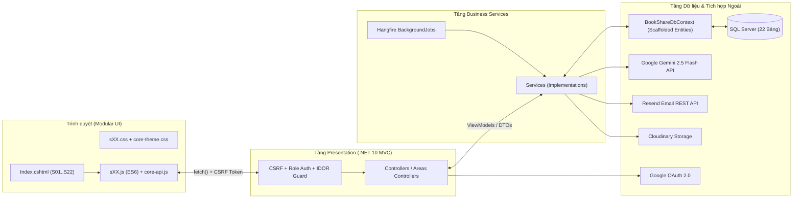
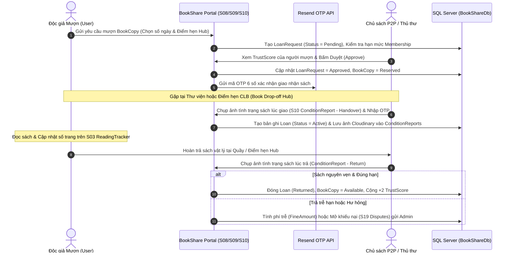

# KIẾN TRÚC TỔNG THỂ HỆ THỐNG BOOKSHARE (ASP.NET CORE 10 MVC)

> **Dự án:** BookShare — Nền tảng Quản lý Tủ sách Cá nhân, Theo dõi Tiến độ Đọc & Chia sẻ Sách Giấy Cộng đồng (Kho chung Thư viện & P2P)  
> **Nền tảng kỹ thuật:** ASP.NET Core 10 MVC (.NET 10) • EF Core 10 (Database-First Scaffold) • SQL Server • ASP.NET Core Identity • Hangfire • Gemini 2.5 Flash • Resend API • Cloudinary  
> **Kế thừa & Mở rộng:** Phát triển từ nền tảng giao diện và trải nghiệm của `book-tracker-ver07` lên cổng dịch vụ (Portal) 4 cấp phân quyền và 22 dịch vụ độc lập.

---

## 1. Nguyên tắc Nghiệp vụ Bất khả Xâm phạm

1. **Định vị hệ thống ("Airbnb cho sách giấy" + Trợ lý đọc sách cá nhân):**
   - Kết hợp **Quản lý tủ sách cá nhân & Theo dõi tiến độ đọc** (kế thừa từ `book-tracker-ver07`) với **Mượn sách Kho chung (Thư viện trường/đối tác)** và **Mượn sách P2P giữa các cá nhân**.
2. **TUYỆT ĐỐI KHÔNG PHẢI WEB BÁN SÁCH:**
   - **Cấm tuyệt đối:** Nút `"Mua ngay"`, `"Thêm vào giỏ hàng"`, trang thanh toán mua bán sách, hoặc hiển thị `"Giá bán sách"`.
   - **Luồng nghiệp vụ chuẩn:** Quản lý kệ sách $\rightarrow$ Đặt mượn / Xếp hàng chờ $\rightarrow$ Duyệt yêu cầu $\rightarrow$ Giao/Nhận sách (kèm chụp ảnh tình trạng `ConditionReports`) $\rightarrow$ Theo dõi tiến độ đọc (`ReadingProgresses`) $\rightarrow$ Trả sách & Đánh giá uy tín 2 chiều (`TrustScore`).
   - Mọi giao dịch tài chính trên hệ thống (qua cổng Sandbox VNPay/MoMo) chỉ phục vụ: **Nâng cấp gói thành viên (Premium)**, **Nộp phí phạt trả trễ hạn (`FineAmount`)**, và **Tiền cọc mô phỏng (`SimulatedDeposit`)**.
3. **Chỉ giao dịch & chia sẻ Sách Giấy vật lý:**
   - Nghiêm cấm tải lên, lưu trữ hoặc chia sẻ tệp sách điện tử (Ebook/PDF/EPUB) vi phạm bản quyền. Mỗi bản sao vật lý được định danh bằng mã vạch (`Barcode`) trong bảng `BookCopies`.

---

## 2. Hệ thống Phân quyền 4 Vai trò (ASP.NET Core Identity Roles)

Hệ thống sử dụng ASP.NET Core Identity với 4 vai trò (`AspNetRoles`) được phân tách rõ ràng theo Areas và Policy:

| STT | Mã Role | Tên Vai trò | Phạm vi Truy cập & Trách nhiệm Cốt lõi | Areas / Route Chính |
| :--- | :--- | :--- | :--- | :--- |
| **1** | `User` | **Độc giả & Chủ tủ sách cá nhân** | Quản lý tủ sách cá nhân (`Shelves`), bật/tắt trạng thái cho mượn (`IsLendable`), theo dõi tiến độ đọc & ghi chú (kế thừa Ver07), đặt mượn sách kho chung hoặc P2P, chụp ảnh biên bản tình trạng sách, đánh giá `TrustScore`. | Default Route (`/Modules/...`) |
| **2** | `Curator` | **Chủ nhiệm CLB / Điểm trạm Kiểm định P2P** | Xác minh sách thật ngoài đời tại câu lạc bộ/trường học, quản lý tủ sách CLB/nhóm sinh viên, vận hành Điểm hẹn giao nhận sách an toàn (`Book Drop-off Hub`), hỗ trợ xác nhận giao nhận P2P. | `/Curator/...` (`Area("Curator")`) |
| **3** | `Librarian` | **Thủ thư Kho chung** | Quản lý kho sách thư viện trường/đối tác (`Libraries`), nhập lô sách mới bằng ISBN/Barcode, quét mã duyệt nhanh mượn/trả tại quầy, ghi nhận tình trạng sách trả và tính phí phạt trễ hạn. | `/Librarian/...` (`Area("Librarian")`) |
| **4** | `Admin` | **Quản trị viên Hệ thống** | Quản lý toàn bộ tài khoản, phê duyệt quyền Thủ thư/Curator, phân xử tranh chấp sách hỏng/mất (`Disputes`) dựa trên ảnh biên bản, cấu hình gói thành viên (`Memberships`), xem Dashboard thống kê & giám sát Hangfire Jobs. | `/Admin/...` (`Area("Admin")`) |

---

## 3. Cấu trúc Thư mục Chuẩn Đối xứng (`BookShare.Solution`)

Mỗi dịch vụ trong 22 dịch vụ bắt buộc sở hữu **1 bộ 3 file tách biệt hoàn toàn** (`1 View .cshtml` + `1 Style .css` + `1 Script .js` ES6 Module) để đảm bảo tính đóng gói (Modularity), không bao giờ xảy ra xung đột CSS/JS khi phát triển song song:

```plaintext
BookShare.Solution/
├── .env                                  # Biến môi trường thật (Đã khóa trong .gitignore)
├── .env.example                          # Mẫu cấu hình biến môi trường chuẩn .NET 10 (Dấu __)
├── .gitignore                            # Chặn commit .env, bin/, obj/, .vs/
├── _reference/                           # Tài liệu gốc & mã nguồn tham chiếu book-tracker-ver07
├── docs/
│   ├── ARCHITECTURE.md                   # Bản đồ kiến trúc & danh sách 22 dịch vụ
│   ├── RULES.md                          # Quy chuẩn kỹ thuật khóa chặt cho đội ngũ & AI
│   ├── PROGRESS.md                       # Bảng theo dõi tiến độ 5 giai đoạn phát triển
│   └── ui-previews/                      # Bộ mẫu giao diện (HTML/CSS/JS) trực quan để duyệt
│       ├── 01-portal-discovery-s06.html
│       ├── 02-personal-shelf-tracker-s02-s03.html
│       ├── 03-p2p-loan-condition-s09-s10.html
│       └── 04-librarian-admin-desk-s21-s22.html
├── database/
│   ├── 01_BookShare_Schema.sql           # Script T-SQL tạo 22 bảng SQL Server (Chuẩn Scaffold)
│   └── 02_BookShare_SeedData.sql         # Dữ liệu mẫu (4 roles, 3 thư viện, 30 đầu sách, 50 bản sao)
└── src/
    └── BookShare.Web/                    # Project ASP.NET Core 10 MVC chính
        ├── Program.cs                    # Điểm khởi đầu: DotNetEnv.Env.Load(), DI, Auth, Hangfire
        ├── appsettings.json              # Cấu hình mặc định không chứa khóa nhạy cảm
        ├── Areas/
        │   ├── Admin/                    # Khu vực Quản trị viên (S19, S22)
        │   │   ├── Controllers/
        │   │   └── Views/
        │   │       ├── S19_DisputeResolution/Index.cshtml
        │   │       └── S22_AdminAnalytics/Index.cshtml
        │   ├── Librarian/                # Khu vực Thủ thư kho chung (S07, S08, S21)
        │   │   ├── Controllers/
        │   │   └── Views/
        │   │       └── S21_LibrarianDesk/Index.cshtml
        │   └── Curator/                  # Khu vực Chủ nhiệm CLB / Điểm trạm P2P (S20)
        │       ├── Controllers/
        │       └── Views/
        │           └── S20_ExchangeHubClub/Index.cshtml
        ├── Controllers/                  # Các Controller phía User, Chung & REST API nội bộ
        ├── Models/
        │   ├── Entities/                 # Code tự sinh từ `dotnet ef dbcontext scaffold` (CẤM SỬA TAY)
        │   └── ViewModels/               # DTO / ViewModel riêng cho từng dịch vụ S01 -> S22
        ├── Services/
        │   ├── Interfaces/               # IAuthService, IShelfService, ILoanService, IGeminiAiService...
        │   └── Implementations/          # Toàn bộ Business Logic (Controller cấm gọi thẳng DbContext)
        ├── BackgroundJobs/               # Hangfire Jobs: nhắc hạn Resend, tính phí trễ, hủy đơn quá 48h
        ├── Views/
        │   ├── Shared/
        │   │   ├── _Layout.cshtml        # Portal Header, Search Bar lớn, Status Banner, AI Chat Widget nổi
        │   │   ├── _StatusBanner.cshtml  # Khung báo mã trạng thái 200/300/400/404/500 kế thừa Ver07
        │   │   └── _AiChatWidget.cshtml  # Hộp thoại Chat Gemini nổi góc phải dưới màn hình
        │   └── Modules/                  # THƯ MỤC GIAO DIỆN CỦA CÁC DỊCH VỤ CHUNG & USER
        │       ├── S01_AuthOtpGoogle/Index.cshtml
        │       ├── S02_PersonalShelf/Index.cshtml
        │       ├── S03_ReadingTracker/Index.cshtml
        │       ├── S04_BookNotesQuotes/Index.cshtml
        │       ├── S05_IsbnAutoCatalog/Index.cshtml
        │       ├── S06_SearchDiscovery/Index.cshtml
        │       ├── S07_LibraryCatalog/Index.cshtml
        │       ├── S08_LibraryLoanFlow/Index.cshtml
        │       ├── S09_P2PLoanFlow/Index.cshtml
        │       ├── S10_ConditionReport/Index.cshtml
        │       ├── S11_HotBookQueue/Index.cshtml
        │       ├── S12_LoanRenewalFine/Index.cshtml
        │       ├── S13_GeminiAiAssistant/Index.cshtml
        │       ├── S14_AiRecommendation/Index.cshtml
        │       ├── S15_TrustScoreReview/Index.cshtml
        │       ├── S16_MembershipTier/Index.cshtml
        │       ├── S17_SandboxPayment/Index.cshtml
        │       └── S18_NotificationHub/Index.cshtml
        └── wwwroot/
            ├── fonts/                    # Bộ font Roboto nội bộ kế thừa từ book-tracker-ver07
            ├── css/
            │   └── core-theme.css        # Biến CSS dùng chung, Font Roboto, Status Banner, Portal Layout
            ├── js/
            │   └── core-api.js           # Hàm fetch() bọc sẵn CSRF Token, Status Banner & Toast
            └── modules/                  # 22 BỘ CSS & JS ĐỘC LẬP CHO TỪNG DỊCH VỤ (S01 -> S22)
                ├── s01-auth-otp-google/
                │   ├── s01-auth-otp-google.css
                │   └── s01-auth-otp-google.js
                ├── s02-personal-shelf/
                │   ├── s02-personal-shelf.css
                │   └── s02-personal-shelf.js
                ├── ... (đối xứng 1-1 từ s01 đến s22)
                └── s22-admin-analytics/
                    ├── s22-admin-analytics.css
                    └── s22-admin-analytics.js
```

---

## 4. Bảng Quy hoạch Chi tiết 22 Dịch vụ Độc lập (Modular Services Map)

Mỗi dịch vụ dưới đây được ánh xạ chính xác tới **Bộ 3 file (CSHTML + CSS + JS)**, **Tầng Service**, và **Các bảng CSDL** chịu trách nhiệm:

| Mã DV | Tên Dịch vụ (Module) | Nhóm Đối tượng | Đường dẫn Bộ 3 File Độc lập (1 CSHTML + 1 CSS + 1 JS) | Service Interface & Bảng DB Chính |
| :--- | :--- | :--- | :--- | :--- |
| **S01** | `AuthOtpGoogle` | Chung | • `Views/Modules/S01_AuthOtpGoogle/Index.cshtml`<br>• `wwwroot/modules/s01-auth-otp-google/s01-auth-otp-google.css`<br>• `wwwroot/modules/s01-auth-otp-google/s01-auth-otp-google.js` | `IAuthOtpService`, `IResendEmailService`<br>*(AspNetUsers, AspNetRoles, AspNetUserRoles, AspNetUserLogins, OtpVerifications)* |
| **S02** | `PersonalShelf` | `User` | • `Views/Modules/S02_PersonalShelf/Index.cshtml`<br>• `wwwroot/modules/s02-personal-shelf/s02-personal-shelf.css`<br>• `wwwroot/modules/s02-personal-shelf/s02-personal-shelf.js` | `IPersonalShelfService`<br>*(Shelves, ShelfItems, BookCopies, Books)* |
| **S03** | `ReadingTracker` | `User` | • `Views/Modules/S03_ReadingTracker/Index.cshtml`<br>• `wwwroot/modules/s03-reading-tracker/s03-reading-tracker.css`<br>• `wwwroot/modules/s03-reading-tracker/s03-reading-tracker.js` | `IReadingTrackerService`<br>*(ReadingProgresses, Books)* |
| **S04** | `BookNotesQuotes` | `User` | • `Views/Modules/S04_BookNotesQuotes/Index.cshtml`<br>• `wwwroot/modules/s04-book-notes-quotes/s04-book-notes-quotes.css`<br>• `wwwroot/modules/s04-book-notes-quotes/s04-book-notes-quotes.js` | `IBookNoteService`<br>*(BookNotes, ReadingProgresses)* |
| **S05** | `IsbnAutoCatalog` | `User`, `Librarian` | • `Views/Modules/S05_IsbnAutoCatalog/Index.cshtml`<br>• `wwwroot/modules/s05-isbn-auto-catalog/s05-isbn-auto-catalog.css`<br>• `wwwroot/modules/s05-isbn-auto-catalog/s05-isbn-auto-catalog.js` | `IIsbnCatalogService`<br>*(Books, Categories, BookCopies)* |
| **S06** | `SearchDiscovery` | Chung | • `Views/Modules/S06_SearchDiscovery/Index.cshtml`<br>• `wwwroot/modules/s06-search-discovery/s06-search-discovery.css`<br>• `wwwroot/modules/s06-search-discovery/s06-search-discovery.js` | `ISearchDiscoveryService`<br>*(Books, Categories, BookCopies, Libraries, AspNetUsers)* |
| **S07** | `LibraryCatalog` | `Librarian`, Chung | • `Views/Modules/S07_LibraryCatalog/Index.cshtml`<br>• `wwwroot/modules/s07-library-catalog/s07-library-catalog.css`<br>• `wwwroot/modules/s07-library-catalog/s07-library-catalog.js` | `ILibraryCatalogService`<br>*(Libraries, BookCopies, Books)* |
| **S08** | `LibraryLoanFlow` | `User`, `Librarian` | • `Views/Modules/S08_LibraryLoanFlow/Index.cshtml`<br>• `wwwroot/modules/s08-library-loan-flow/s08-library-loan-flow.css`<br>• `wwwroot/modules/s08-library-loan-flow/s08-library-loan-flow.js` | `ILibraryLoanService`<br>*(LoanRequests, Loans, BookCopies, Libraries)* |
| **S09** | `P2PLoanFlow` | `User` $\leftrightarrow$ `User` | • `Views/Modules/S09_P2PLoanFlow/Index.cshtml`<br>• `wwwroot/modules/s09-p2p-loan-flow/s09-p2p-loan-flow.css`<br>• `wwwroot/modules/s09-p2p-loan-flow/s09-p2p-loan-flow.js` | `IP2PLoanService`<br>*(LoanRequests, Loans, BookCopies, AspNetUsers)* |
| **S10** | `ConditionReport` | `User`, `Librarian` | • `Views/Modules/S10_ConditionReport/Index.cshtml`<br>• `wwwroot/modules/s10-condition-report/s10-condition-report.css`<br>• `wwwroot/modules/s10-condition-report/s10-condition-report.js` | `IConditionReportService`, `ICloudinaryService`<br>*(ConditionReports, Loans, BookCopies)* |
| **S11** | `HotBookQueue` | `User` | • `Views/Modules/S11_HotBookQueue/Index.cshtml`<br>• `wwwroot/modules/s11-hot-book-queue/s11-hot-book-queue.css`<br>• `wwwroot/modules/s11-hot-book-queue/s11-hot-book-queue.js` | `IReservationQueueService`<br>*(Reservations, Books, BookCopies, Memberships)* |
| **S12** | `LoanRenewalFine` | `User`, `Librarian` | • `Views/Modules/S12_LoanRenewalFine/Index.cshtml`<br>• `wwwroot/modules/s12-loan-renewal-fine/s12-loan-renewal-fine.css`<br>• `wwwroot/modules/s12-loan-renewal-fine/s12-loan-renewal-fine.js` | `ILoanRenewalFineService`<br>*(Loans, Transactions)* |
| **S13** | `GeminiAiAssistant` | Chung (AI) | • `Views/Modules/S13_GeminiAiAssistant/Index.cshtml`<br>• `wwwroot/modules/s13-gemini-ai-assistant/s13-gemini-ai-assistant.css`<br>• `wwwroot/modules/s13-gemini-ai-assistant/s13-gemini-ai-assistant.js` | `IGeminiAiService`<br>*(AiChatSessions, AiChatMessages, Books, Loans)* |
| **S14** | `AiRecommendation` | `User` (AI) | • `Views/Modules/S14_AiRecommendation/Index.cshtml`<br>• `wwwroot/modules/s14-ai-recommendation/s14-ai-recommendation.css`<br>• `wwwroot/modules/s14-ai-recommendation/s14-ai-recommendation.js` | `IAiRecommendationService`<br>*(ReadingProgresses, Loans, Books, Categories)* |
| **S15** | `TrustScoreReview` | `User` | • `Views/Modules/S15_TrustScoreReview/Index.cshtml`<br>• `wwwroot/modules/s15-trust-score-review/s15-trust-score-review.css`<br>• `wwwroot/modules/s15-trust-score-review/s15-trust-score-review.js` | `ITrustScoreReviewService`<br>*(Reviews, AspNetUsers, Loans)* |
| **S16** | `MembershipTier` | `User` | • `Views/Modules/S16_MembershipTier/Index.cshtml`<br>• `wwwroot/modules/s16-membership-tier/s16-membership-tier.css`<br>• `wwwroot/modules/s16-membership-tier/s16-membership-tier.js` | `IMembershipService`<br>*(Memberships, AspNetUsers)* |
| **S17** | `SandboxPayment` | `User`, `Admin` | • `Views/Modules/S17_SandboxPayment/Index.cshtml`<br>• `wwwroot/modules/s17-sandbox-payment/s17-sandbox-payment.css`<br>• `wwwroot/modules/s17-sandbox-payment/s17-sandbox-payment.js` | `ISandboxPaymentService`<br>*(Transactions, Memberships, Loans)* |
| **S18** | `NotificationHub` | Chung | • `Views/Modules/S18_NotificationHub/Index.cshtml`<br>• `wwwroot/modules/s18-notification-hub/s18-notification-hub.css`<br>• `wwwroot/modules/s18-notification-hub/s18-notification-hub.js` | `INotificationService`, `IResendEmailService`<br>*(Notifications)* |
| **S19** | `DisputeResolution` | `User`, `Admin` | • `Areas/Admin/Views/S19_DisputeResolution/Index.cshtml`<br>• `wwwroot/modules/s19-dispute-resolution/s19-dispute-resolution.css`<br>• `wwwroot/modules/s19-dispute-resolution/s19-dispute-resolution.js` | `IDisputeResolutionService`<br>*(Disputes, ConditionReports, Loans, AspNetUsers)* |
| **S20** | `ExchangeHubClub` | `Curator`, `User` | • `Areas/Curator/Views/S20_ExchangeHubClub/Index.cshtml`<br>• `wwwroot/modules/s20-exchange-hub-club/s20-exchange-hub-club.css`<br>• `wwwroot/modules/s20-exchange-hub-club/s20-exchange-hub-club.js` | `IExchangeHubClubService`<br>*(Libraries, LoanRequests, BookCopies)* |
| **S21** | `LibrarianDesk` | `Librarian` | • `Areas/Librarian/Views/S21_LibrarianDesk/Index.cshtml`<br>• `wwwroot/modules/s21-librarian-desk/s21-librarian-desk.css`<br>• `wwwroot/modules/s21-librarian-desk/s21-librarian-desk.js` | `ILibrarianDeskService`<br>*(BookCopies, LoanRequests, Loans, ConditionReports)* |
| **S22** | `AdminAnalytics` | `Admin` | • `Areas/Admin/Views/S22_AdminAnalytics/Index.cshtml`<br>• `wwwroot/modules/s22-admin-analytics/s22-admin-analytics.css`<br>• `wwwroot/modules/s22-admin-analytics/s22-admin-analytics.js` | `IAdminAnalyticsService`<br>*(Toàn bộ 22 bảng + Hangfire Dashboard)* |

---

## 5. Sơ đồ Luồng Kiến trúc & Tích hợp Dịch vụ

### 5.1. Kiến trúc Phân tầng (Layered Architecture)



### 5.2. Luồng Mượn Sách P2P & Kho Chung Kèm Kiểm Định Tình Trạng Sách



### 5.3. Luồng Trợ lý AI Gemini (RAG Nhẹ Kết hợp Ngữ cảnh CSDL)

1. Người dùng gửi tin nhắn từ module `S13_GeminiAiAssistant` hoặc hộp thoại nổi `_AiChatWidget.cshtml` tới endpoint `POST /api/ai-chat/send`.
2. `GeminiAiService` ở tầng Backend truy vấn nhanh ngữ cảnh cá nhân hóa (Lightweight RAG):
   - Danh sách các đầu sách sẵn sàng cho mượn (`BookCopies.Status == 'Available'`).
   - Tiến độ đọc hiện tại của người dùng (`ReadingProgresses`) và các khoản vay sắp đến hạn (`Loans.DueDate`).
3. Hệ thống ghép ngữ cảnh trên vào `SystemInstruction` và gọi REST API của `gemini-2.5-flash` bằng khóa bảo mật từ biến môi trường (`Gemini__ApiKey`).
4. Lưu cặp tin nhắn `User` và `Gemini` (kèm số `PromptTokens` và mảng `ReferencedBookIdsJson`) vào bảng `AiChatMessages`, sau đó trả JSON về giao diện để hiển thị an toàn qua `innerText` (chống XSS).
