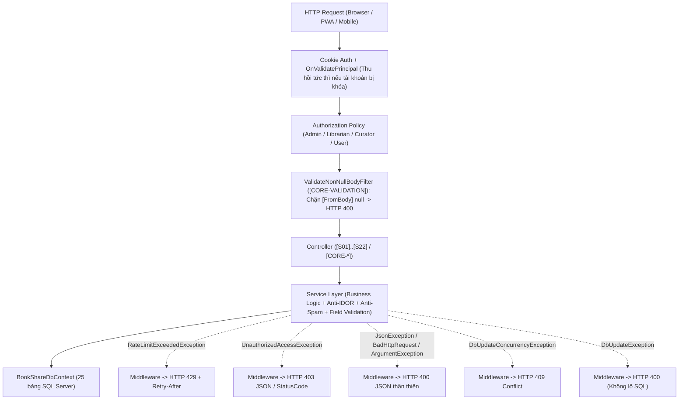

# Bản Đồ Mã Dịch Vụ & Tài Liệu Kiến Trúc Cho Lập Trình Viên (BookShare v5.4)

Tài liệu này giúp lập trình viên mới nhanh chóng nắm bắt **cấu trúc phân mã dịch vụ**, **kiến trúc Strict Service Layer**, **ma trận phân quyền RBAC/Anti-IDOR**, **cơ chế chống spam & kiểm tra dữ liệu đầu vào** và **vòng đời nghiệp vụ** trên toàn bộ hệ sinh thái **BookShare**.

> **Quy tắc kiến trúc bắt buộc (Strict Service Layer):**
> - Mọi `Controller` trong `src/BookShare.Web/Controllers/` **tuyệt đối không** inject hoặc gọi trực tiếp `BookShareDbContext`. Toàn bộ truy vấn EF Core và quy tắc nghiệp vụ phải nằm trong `src/BookShare.Web/Services/Implementations/`.
> - Mã dịch vụ (`[S01]`–`[S22]`, `[CORE-*]`) chỉ dùng trong **mã nguồn, XML docblock và tài liệu kỹ thuật** — **không bao giờ hiển thị** ra giao diện người dùng cuối.
> - Hệ thống hoạt động 100% phi thương mại (**mượn trả sách giấy miễn phí 0đ**).

---

## 1. Kiến Trúc Xử Lý Yêu Cầu, Kiểm Tra Đầu Vào & Bắt Ngoại Lệ Toàn Cục



---

## 2. Bảng Ánh Xạ 22 Phân Hệ Nghiệp Vụ (`[S01]` – `[S22]`)

| Mã | Tên phân hệ | Controller | Interface | Implementation | View / JS Module | Quyền truy cập chính |
| :--- | :--- | :--- | :--- | :--- | :--- | :--- |
| **`[S01]`** | Tài khoản, OTP, Google & Cài đặt Giao diện | `S01AuthOtpGoogleController` | `IS01AuthOtpService` | `S01AuthOtpService` | `S01_AuthOtpGoogle` / `s01-auth-otp-google.js` | Công khai (Đăng nhập/ĐK/Quên MK) & Thành viên (Hồ sơ/Avatar/UI) |
| **`[S02]`** | Tủ sách Cá nhân & Kệ sách | `S02PersonalShelfController` | `IS02PersonalShelfService` | `S02PersonalShelfService` | `S02_PersonalShelf` / `s02-personal-shelf.js` | Thành viên (Chủ sở hữu kệ/sách) & Admin |
| **`[S03]`** | Theo dõi Tiến độ Đọc sách | `S03ReadingTrackerController` | `IS03ReadingTrackerService` | `S03ReadingTrackerService` | `S03_ReadingTracker` / `s03-reading-tracker.js` | Thành viên (Tiến độ cá nhân) |
| **`[S04]`** | Sổ tay Ghi chú & Trích dẫn | `S04BookNotesQuotesController` | `IS04BookNotesService` | `S04BookNotesService` | `S04_BookNotesQuotes` / `s04-book-notes-quotes.js` | Công khai xem trích dẫn chia sẻ; Thành viên CRUD ghi chú riêng |
| **`[S05]`** | Quét mã ISBN & Biên mục Tự động | `S05IsbnAutoCatalogController` | `IS05IsbnCatalogService` | `S05IsbnCatalogService` | `S05_IsbnAutoCatalog` / `s05-isbn-auto-catalog.js` | Thành viên (thêm bản sao cá nhân); Thủ thư/Admin (Kho chung & sửa/xóa đầu sách) |
| **`[S06]`** | Tìm kiếm & Khám phá Đa tiêu chí | `S06SearchDiscoveryController` | `IS06SearchDiscoveryService` | `S06SearchDiscoveryService` | `S06_SearchDiscovery` / `s06-search-discovery.js` | Công khai tra cứu; Thành viên đặt mượn nhanh |
| **`[S07]`** | Kho chung Thư viện Đối tác | `S07LibraryCatalogController` | `IS07LibraryCatalogService` | `S07LibraryCatalogService` | `S07_LibraryCatalog` / `s07-library-catalog.js` | Công khai xem kho; Thủ thư/Admin điều chuyển vị trí kệ |
| **`[S08]`** | Luồng Mượn – Trả Kho Thư viện | `S08LibraryLoanFlowController` | `IS08LibraryLoanService` | `S08LibraryLoanService` | `S08_LibraryLoanFlow` / `s08-library-loan-flow.js` | Độc giả (tạo/hủy phiếu); Thủ thư/Admin (duyệt/giao/nhận trả) |
| **`[S09]`** | Luồng Mượn – Trả Cộng đồng P2P | `S09P2PLoanFlowController` | `IS09P2PLoanService` | `S09P2PLoanService` | `S09_P2PLoanFlow` / `s09-p2p-loan-flow.js` | Độc giả (tạo/hủy); Chủ sách (duyệt); Chủ sách/Trưởng-Phó CLB/Thủ thư/Admin (chuyển bước) |
| **`[S10]`** | Hộ chiếu Kiểm định Tình trạng Sách | `S10ConditionReportController` | `IS10ConditionReportService` | `S10ConditionReportService` | `S10_ConditionReport` / `s10-condition-report.js` | Chỉ bên liên quan hợp đồng (Người mượn/Chủ sách) & Curator/Librarian/Admin |
| **`[S11]`** | Hàng chờ Đặt trước Sách Hot | `S11HotBookQueueController` | `IS11HotBookQueueService` | `S11HotBookQueueService` | `S11_HotBookQueue` / `s11-hot-book-queue.js` | Thành viên (đăng ký/hủy lượt riêng); Thủ thư/Admin (kích hoạt báo lượt #1) |
| **`[S12]`** | Gia hạn Mượn & Phí Trễ hạn | `S12LoanRenewalFineController` | `IS12LoanRenewalFineService` | `S12LoanRenewalFineService` | `S12_LoanRenewalFine` / `s12-loan-renewal-fine.js` | Độc giả (gia hạn hợp đồng riêng); Thủ thư/Admin (tính/chốt phí trễ) |
| **`[S13]`** | Trợ lý Đọc sách AI Gemini | `S13GeminiAiAssistantController` | `IS13GeminiAiService` | `S13GeminiAiService` | `S13_GeminiAiAssistant` / `s13-gemini-ai-assistant.js` | Thành viên đã đăng nhập (lưu chat tách biệt theo vai trò, gửi 7 loại báo cáo Email) |
| **`[S14]`** | Gợi ý Sách Cá nhân hóa & Lộ trình | `S14AiRecommendationController` | `IS14AiRecommendationService` | `S14AiRecommendationService` | `S14_AiRecommendation` / `s14-ai-recommendation.js` | Công khai & Cá nhân hóa theo tài khoản |
| **`[S15]`** | Điểm Uy tín & Đánh giá Hai chiều | `S15TrustScoreReviewController` | `IS15TrustScoreReviewService` | `S15TrustScoreReviewService` | `S15_TrustScoreReview` / `s15-trust-score-review.js` | Thành viên (đánh giá thành viên khác yêu cầu có hợp đồng hoàn tất giữa hai bên) |
| **`[S16]`** | Hạng Hội viên 4 Cấp | `S16MembershipTierController` | `IS16MembershipTierService` | `S16MembershipTierService` + `MembershipTierCatalog` | `S16_MembershipTier` / `s16-membership-tier.js` | Thành viên (đăng ký/chuyển đổi/hủy gói riêng); Admin (quản trị toàn hệ thống) |
| **`[S17]`** | Ví Bảo Lãnh & Thanh toán Tiền ảo | `S17SandboxPaymentController` | `IS17SandboxPaymentService` | `S17SandboxPaymentService` | `S17_SandboxPayment` / `s17-sandbox-payment.js` | Thành viên (nạp ví ảo/thanh toán đơn riêng); Thủ thư/Admin (hoàn cọc) |
| **`[S18]`** | Trung tâm Thông báo & Xác minh OTP | `S18NotificationHubController` | `IS18NotificationHubService` | `S18NotificationHubService` | `S18_NotificationHub` / `s18-notification-hub.js` | Thành viên (thông báo & OTP Email riêng); Thủ thư/Admin (gửi chiến dịch Email) |
| **`[S19]`** | Khiếu nại & Phân xử Tranh chấp | `S19DisputeResolutionController` | `IS19DisputeResolutionService` | `S19DisputeResolutionService` | `S19_DisputeResolution` / `s19-dispute-resolution.js` | Bên liên quan mở/sửa/rút khiếu nại; **Chỉ Admin** ban hành phán quyết |
| **`[S20]`** | Câu lạc bộ Sách & Điểm trạm Giao nhận | `S20ExchangeHubClubController` | `IS20ExchangeHubClubService` | `S20ExchangeHubClubService` | `S20_ExchangeHubClub` / `s20-exchange-hub-club.js` | Thành viên tham gia CLB; Trưởng/Phó từng CLB điều hành CLB riêng; Admin toàn quyền |
| **`[S21]`** | Quầy Nghiệp vụ Thủ thư Hợp nhất | `S21LibrarianDeskController` | `IS21LibrarianDeskService` | `S21LibrarianDeskService` | `S21_LibrarianDesk` / `s21-librarian-desk.js` | **Chỉ Thủ thư (`Librarian`) & Quản trị viên (`Admin`)** |
| **`[S22]`** | Trung tâm Quản trị & Thống kê Biểu đồ | `S22AdminAnalyticsController` | `IS22AdminAnalyticsService` | `S22AdminAnalyticsService` | `S22_AdminAnalytics` / `s22-admin-analytics.js` | **Chỉ Quản trị viên (`Admin`)** |

---

## 3. Bảng Ánh Xạ Dịch Vụ Lõi & Nền Tảng (`[CORE-*]`)

| Mã | Thành phần | Tệp nguồn | Vai trò kỹ thuật |
| :--- | :--- | :--- | :--- |
| **`[CORE-BOOTSTRAP]`** | Điểm khởi động ứng dụng | `Program.cs` | Nạp `.env`, DI Container, Cookie/Google Auth, 4 chính sách RBAC, Filter chặn null body, Exception Middleware, Hangfire. |
| **`[CORE-VALIDATION]`** | Bộ lọc chặn dữ liệu rỗng | `Filters/ValidateNonNullBodyFilter.cs` | Tự động chặn mọi tham số `[FromBody]` không cho phép null khi client gửi `null`/JSON hỏng -> trả HTTP 400 chuẩn tiếng Việt. |
| **`[CORE-ANTISPAM]`** | Giới hạn tần suất & Khóa brute-force | `IAntiSpamRateLimiterService` / `AntiSpamRateLimiterService` | Cửa sổ trượt theo User/IP (`TryConsume` -> HTTP 429 + `Retry-After`) và đếm lỗi OTP/Mật khẩu (`RecordFailure` -> khóa 10 phút). |
| **`[CORE-AUTH]`** | Tiện ích xác thực & reCAPTCHA | `AuthConfigHelper` / `RecaptchaService` | Kiểm tra Email, SĐT Việt Nam (`IsValidVietnamPhone`), URL ảnh an toàn (`IsSafeImageUrl`), dựng Claims Cookie, băm SHA-256, kiểm tra reCAPTCHA v3. |
| **`[CORE-DB]`** | Ngữ cảnh CSDL & Khởi tạo | `BookShareDbContext` / `DatabaseBootstrapService` | Ánh xạ 25 bảng SQL Server Database-First; tự động vá schema mở rộng, 4 vai trò gốc, tài khoản Admin & 18 biểu tượng mặc định. |
| **`[CORE-COORDINATOR]`** | Điều phối nghiệp vụ Mượn – Trả | `LoanFlowCoordinatorService` | Kiểm tra hạn mức mượn (Gói + Suất thưởng P2P), khóa mượn khi có nợ/tranh chấp, chống duyệt trùng bản sao và báo hàng chờ S11. |
| **`[CORE-EMAIL]`** | Gửi Email & OTP 6 số | `ResendEmailService` | Gửi Email HTML qua Resend API / SMTP, phát hành & xác thực OTP 6 chữ số (hash SHA-256, hiệu lực 5 phút, tối đa 5 lần thử). |
| **`[CORE-ICONS]`** | Quản trị 18 biểu tượng động | `SystemIconService` | Lưu nhị phân biểu tượng trong CSDL + phục vụ tại `/assets/system-icons/{key}` không bị mất ảnh khi restart container. |
| **`[CORE-HOME]`** | Cổng Trang chủ & Trang lỗi | `HomeController` / `PortalDiscoveryService` | Trang chủ lọc đa tiêu chí, API chat nhanh AI, chuyển hướng gợi ý 404 thông minh & chuẩn hóa phản hồi lỗi JSON/HTML. |
| **`[CORE-QR-AUTH]`** | Đăng nhập nhanh qua mã QR | `QrAuthController` / `QrAuthService` | Phiên đăng nhập QR dùng 1 lần giữa 2 thiết bị (không cần nhập mật khẩu). |
| **`[CORE-QR-HANDOVER]`** | Giao nhận & Trả sách qua QR | `HandoverQrController` / `BookHandoverQrService` | Tạo và quét xác nhận giao/trả sách 2 chiều tại quầy thư viện hoặc điểm hẹn CLB. |
| **`[CORE-MOBILE]`** | API Ứng dụng Di động | `MobileApiController` / `MobileCompanionService` | Đồng bộ dữ liệu cá nhân, thông báo đẩy (tự đánh dấu đã đọc khi mở) và quét QR từ thiết bị di động. |
| **`[CORE-JOBS]`** | 3 Tác vụ nền định kỳ | `BackgroundJobs/BookShareDailyJobs.cs` | Hangfire chạy định kỳ: nhắc hạn trả sách (`07:00`), tính phí quá hạn (`00:05`), dọn phiếu & giữ chỗ hết hạn (`*/30`). |
| **`[CORE-JS]`** | Thư viện JS Frontend dùng chung | `wwwroot/js/core-api.js` | `apiFetch` tự động gắn CSRF Token & hiển thị lỗi 4xx/429/5xx, khung quét QR hình vuông tự tắt camera, bộ tùy biến 9 style/13 màu/12 nền/5 font/7 cỡ chữ. |

---

## 4. Ma Trận Phân Quyền 4 Vai Trò + Trưởng/Phó Câu Lạc Bộ

| Nhóm chức năng | Khách (`Guest`) | Độc giả (`User`) | Chủ nhiệm / Trưởng-Phó CLB (`Curator` / `Leader`) | Thủ thư (`Librarian`) | Quản trị viên (`Admin`) |
| :--- | :---: | :---: | :---: | :---: | :---: |
| Khám phá kho sách, tìm kiếm (`Home`, `S06`, `S07`) | ✅ | ✅ | ✅ | ✅ | ✅ |
| Tủ sách cá nhân, tiến độ đọc, ghi chú, hàng chờ (`S02`–`S04`, `S11`) | ❌ | ✅ (chính mình) | ✅ (chính mình) | ✅ (chính mình) | ✅ (toàn quyền) |
| Gửi / Hủy yêu cầu mượn Kho chung & P2P (`S08`, `S09`) | ❌ | ✅ (phiếu riêng) | ✅ (phiếu riêng + CLB mình) | ✅ (toàn bộ) | ✅ (toàn bộ) |
| Duyệt / Bàn giao / Thu hồi Kho chung & Cho mượn tại quầy (`S08`, `S21`) | ❌ | ❌ | ❌ | ✅ | ✅ |
| Điều hành Câu lạc bộ (Thành viên, Bảng tin, Tủ sách & Đơn CLB `S20`, `S09`) | ❌ | Chỉ xem/tham gia | ✅ (đúng CLB được giao) | Chỉ xem | ✅ (mọi CLB) |
| Biên mục sách vào Kho chung & Sửa/Xóa đầu sách (`S05`, `S07`) | ❌ | Chỉ tủ cá nhân | Chỉ tủ cá nhân | ✅ | ✅ |
| Hộ chiếu kiểm định & Mở khiếu nại (`S10`, `S19`) | ❌ | ✅ (chỉ hợp đồng liên quan) | ✅ (hợp đồng liên quan/CLB) | ✅ | ✅ |
| Phán quyết tranh chấp, quản lý tài khoản/vai trò/khóa, duyệt CLB, đổi 18 icon (`S19`, `S22`) | ❌ | ❌ | ❌ | ❌ | ✅ |

---

## 5. Hướng Dẫn Nhanh Khi Phát Triển / Bảo Trì

1. **Thêm một Endpoint POST mới:**
   - Luôn gắn `[Authorize]` (và `[Authorize(Roles = "...")]` nếu là thao tác đặc quyền) + `[ValidateAntiForgeryToken]`.
   - Không cần viết `if (request == null)` lặp lại vì `ValidateNonNullBodyFilter` đã tự động chặn và trả HTTP 400 tiếng Việt; nhưng với tham số cho phép null hãy khai báo kiểu nullable (`Dto?`).
   - Mọi kiểm tra sở hữu dữ liệu (Anti-IDOR) ném `UnauthorizedAccessException("...")` từ tầng Service để Middleware trả về chuẩn HTTP 403.
   - Mọi thao tác dễ bị spam (gửi Email/OTP, upload tệp, tạo phiếu hàng loạt, đánh giá, nạp ví ảo) gọi `_rateLimiter.TryConsume(...)` và ném `RateLimitExceededException`.
2. **Kiểm tra dữ liệu đầu vào:**
   - Dùng `AuthConfigHelper.IsValidEmailFormat`, `AuthConfigHelper.IsValidVietnamPhone`, `AuthConfigHelper.IsSafeImageUrl` cho Email, Số điện thoại và Đường dẫn ảnh.
   - Khi upload tệp ảnh thật, luôn xác thực phần mở rộng + kích thước + chữ ký nhị phân (Magic Bytes PNG/JPEG/WebP).
3. **Chạy bộ kiểm thử tự động trước khi đẩy mã nguồn:**
   ```powershell
   dotnet build BookShare.sln --nologo
   python scripts/qa_full_bot.py --autostart --no-build
   python scripts/smoke_test.py --autostart --skip-build
   ```
